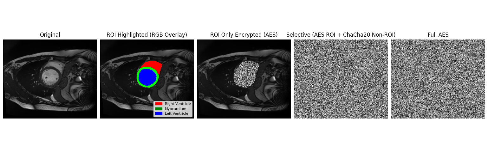
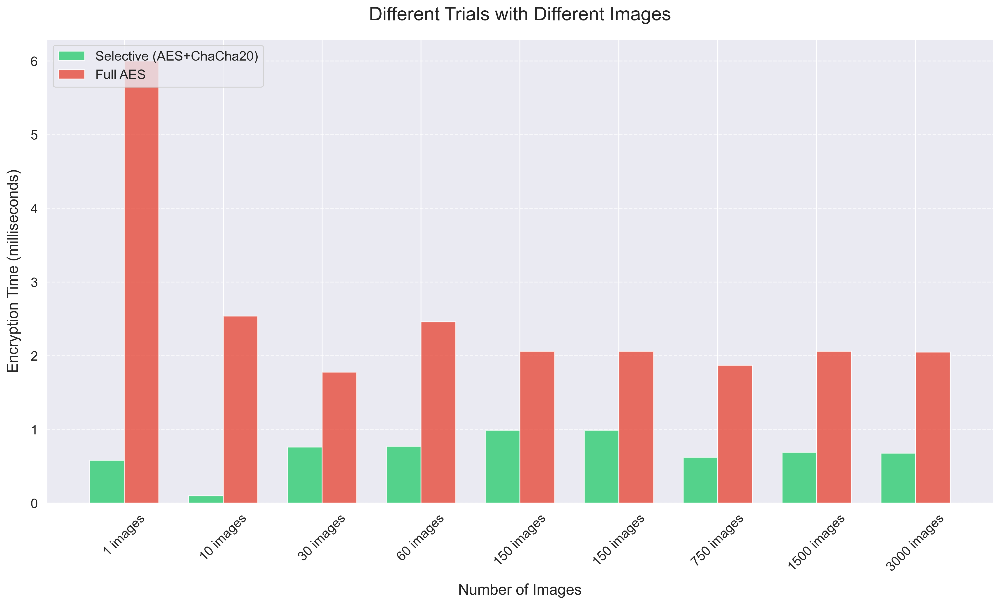

# Selective Encryption for Medical Images

Code for **"Smart Encryption: A Novel Hybrid Approach to Selectively Encrypt Medical Images"**, IEEE NoF 2025. [Paper](https://ieeexplore.ieee.org/abstract/document/11223323)

Cardiac MRI volumes (ACDC) are split with the ground-truth masks: the heart (ROI) is encrypted with **AES-256-CBC**, the rest with **ChaCha20**. Compared to AES on the whole volume, this is about **60–70% faster** with the same statistical security metrics.

<p align="center">
  
</p>

## How it works

1. Load a 3D NIfTI volume and its mask. ROI = labels 1, 2, 3 (RV, myocardium, LV).
2. Normalize to 8 bits (paper setup), or keep the original values with `--keep-intensity`.
3. Encrypt ROI voxels with AES-256-CBC (PKCS7), the rest with ChaCha20. Fresh random IV and nonce for every volume.
4. Store the full ciphertext + IV + nonce, so every volume decrypts back exactly.

## Run it

```bash
pip install -r requirements.txt
```

Put ACDC under `Data/Original/patientXXX/` (`patientXXX_frameYY.nii.gz` + `_gt.nii.gz`). The data is not included, get it from the [ACDC challenge](https://www.creatis.insa-lyon.fr/Challenge/acdc/).

```bash
cd src
python main.py                                   # timing: selective vs full AES (paper setup)
python main.py --keep-intensity                  # lossless, original voxel values
python main.py --out ../results/encrypted --save-keys   # also save encrypted volumes + keys
cd .. && python src/evaluate_security.py         # entropy, correlation, NPCR, UACI, PSNR, MAE, chi-square
streamlit run src/streamlit_app.py               # interactive demo
```

Every run checks that each volume decrypts back to the original (`--no-verify` to skip).

## Results (paper)

| Volumes | Selective (ms) | Full AES (ms) | Gain |
|---:|---:|---:|---:|
| 300 | 0.50 | 1.60 | 69.1% |
| 1500 | 0.60 | 1.90 | 67.0% |
| 3000 | 0.70 | 2.10 | 66.5% |

| | Entropy | Corr. | NPCR | UACI | MAE | PSNR |
|---|---:|---:|---:|---:|---:|---:|
| Original | 6.37 | 1.000 | – | – | – | – |
| Selective | 7.98 | 0.0001 | 99.61% | 39.92% | 101.81 | 6.35 |
| Full AES | 7.98 | 0.0001 | 99.61% | 39.92% | 101.80 | 6.35 |

Timing covers the encryption calls only (the ROI split is a one-time indexing step). Absolute numbers depend on the CPU.

<p align="center"></p>

## Tests

```bash
pytest -q
```

Round trip for uint8 / int16 / float32 volumes, fresh IV and nonce per call, wrong-key failure, save/load, and metric sanity checks.

## Notes

- The 8-bit setup is lossy by design. Use `--keep-intensity` when the exact original values matter.
- The ROI comes from existing segmentation masks. Volumes without a mask are skipped.
- Keys are random per run. Use `--save-keys` / `--keys` to decrypt later, and keep `keys.json` private.
- Research code, not a certified clinical tool.

## Structure

```
src/encryption.py        AES / ChaCha20, encrypt + decrypt volumes, keys
src/processing.py        loading, timing, per-patient pipeline
src/main.py              CLI
src/metrics.py           security metrics
src/evaluate_security.py metrics over saved outputs
src/streamlit_app.py     demo UI
tests/                   pytest
```

## Citation

```bibtex
@inproceedings{hafez2025smart,
  title     = {Smart Encryption: A Novel Hybrid Approach to Selectively Encrypt Medical Images},
  author    = {Hafez, Mohamed and Lee, Hyon and Abdel Hafeez, Khalid},
  booktitle = {2025 16th International Conference on Network of the Future (NoF)},
  pages     = {235--242},
  year      = {2025},
  doi       = {10.1109/NoF66640.2025.11223323}
}
```

Mohamed Hafez, Hyon Lee, Khalid Abdel Hafeez · Ontario Tech University
